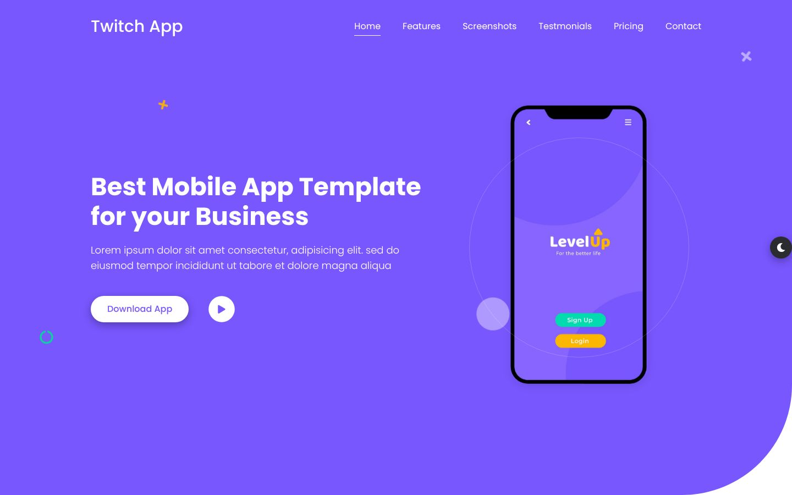
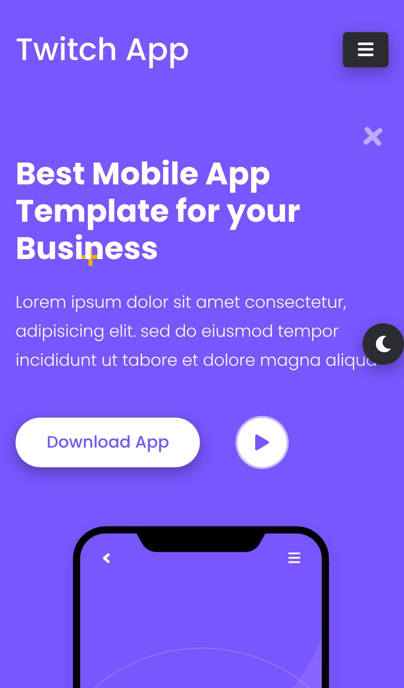
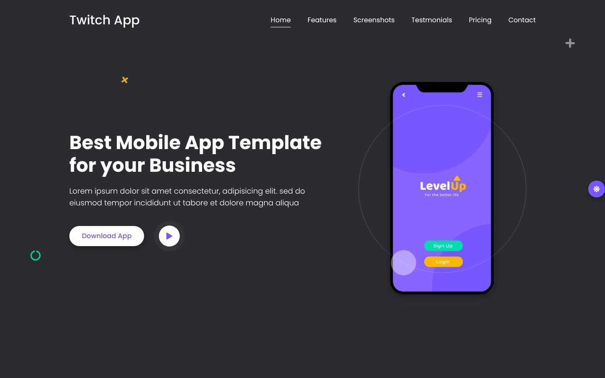
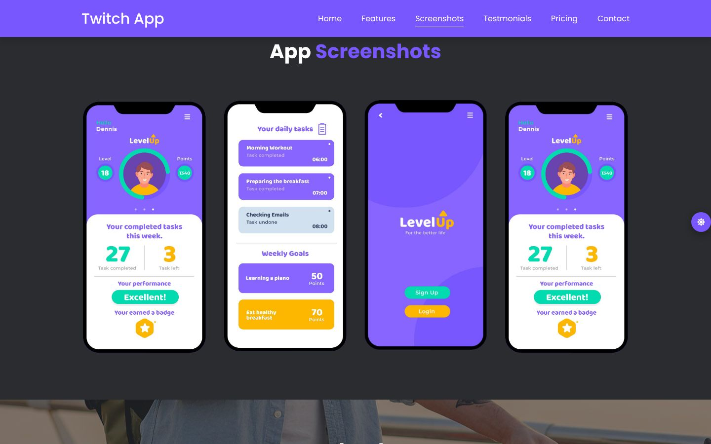

<div align="center">

# Mobile App Landing Page

### One-page app landing page with a light / dark theme toggle

A responsive landing page for a fictional to-do / habit app ("LevelUp"), built with HTML, CSS, Bootstrap 4 and jQuery. It has carousels, a video popup, pricing, FAQ and a theme switch that remembers your choice.

[](https://developer.mozilla.org/docs/Web/HTML)
[](https://developer.mozilla.org/docs/Web/CSS)
[](https://developer.mozilla.org/docs/Web/JavaScript)
[](https://getbootstrap.com)
[](https://jquery.com)
<br>
[](https://eslamraafat1.github.io/Mobile-App/)

**[Live demo](https://eslamraafat1.github.io/Mobile-App/)** ·
**[Portfolio](https://new-portfolio-ashy-xi.vercel.app/)** ·
**[LinkedIn](https://www.linkedin.com/in/eslamraafat-dev/)** ·
**[Email](mailto:eslamraafat736@gmail.com)**

<br>



</div>

<table>
  <tr>
    <td width="33%"></td>
    <td width="67%">
      <br><br>
      
    </td>
  </tr>
  <tr>
    <td align="center"><sub>Mobile (iPhone 13)</sub></td>
    <td align="center"><sub>Dark theme · App screenshots carousel</sub></td>
  </tr>
</table>

---

## Overview

A **practice project** from my 2023 front-end training: a classic one-page landing page for a mobile app, used to practise responsive layout with Bootstrap 4, jQuery plugins and a persisted light / dark theme.

The app, the copy (partly lorem ipsum), the team and the testimonials are placeholders; the page is not for a real product.

## Features

- **Light / dark theme.** A floating button toggles a `dark` class on `<body>`, swaps the moon / sun icon and saves the choice in `localStorage`, so it is restored on the next visit.
- **One-page navigation** with ScrollIt: nav links scroll to their section and the active link follows the scroll position. The navbar shrinks after 80 px of scrolling, and the mobile menu closes after a link is tapped.
- **Four Owl Carousels** (features, app screenshots, testimonials, team) with autoplay and 1 / 2 / 3–4 items depending on screen width.
- **Video popup.** The play button opens an embedded YouTube video in an overlay, and clicking the overlay closes it.
- **Preloader** that fades out once the page has loaded.
- **Sections:** hero, features, fun facts, app screenshots, download, how it works, testimonials, pricing plans, team, FAQ accordion and a contact form (front-end only).

## Tech stack

| Layer | Tools |
| --- | --- |
| Markup | HTML5, single page (`index.html`) |
| Styling | CSS3 (`css/style.css`), Bootstrap 4.5.2, Font Awesome, Google Fonts (Poppins, KoHo) |
| Scripting | jQuery 3.5.1, Popper.js, Bootstrap JS (`js/main.js` for the page logic) |
| Plugins | Owl Carousel 2.3.4, ScrollIt |
| Hosting | GitHub Pages |

## Project structure

```text
.
├── index.html            # the whole landing page
├── css/
│   ├── style.css         # theme styles, including body.dark overrides
│   ├── bootstrap.min.css
│   ├── owl.carousel.min.css
│   └── font-awesome.css
├── js/
│   ├── main.js           # preloader, navbar, carousels, video popup, theme toggle
│   └── …                 # jQuery, Popper, Bootstrap, Owl Carousel, ScrollIt
├── img/                  # app screenshots, team, testimonials, backgrounds
├── webfonts/             # Font Awesome font files
├── website screen/       # full-page captures (light and dark)
└── docs/screenshots/     # README images
```

## Getting started

No build step; it is a static site.

```bash
git clone https://github.com/Eslamraafat1/Mobile-App.git
cd Mobile-App
npx serve .        # or open index.html in a browser
```

## Deployment

The page is served by **GitHub Pages** from the default branch: [eslamraafat1.github.io/Mobile-App](https://eslamraafat1.github.io/Mobile-App/).

## Author

**Eslam Raafat** — Front-End Developer (React · Next.js · TypeScript)

- **Portfolio:** [new-portfolio-ashy-xi.vercel.app](https://new-portfolio-ashy-xi.vercel.app/)
- **LinkedIn:** [linkedin.com/in/eslamraafat-dev](https://www.linkedin.com/in/eslamraafat-dev/)
- **GitHub:** [@Eslamraafat1](https://github.com/Eslamraafat1)
- **Email:** [eslamraafat736@gmail.com](mailto:eslamraafat736@gmail.com)
